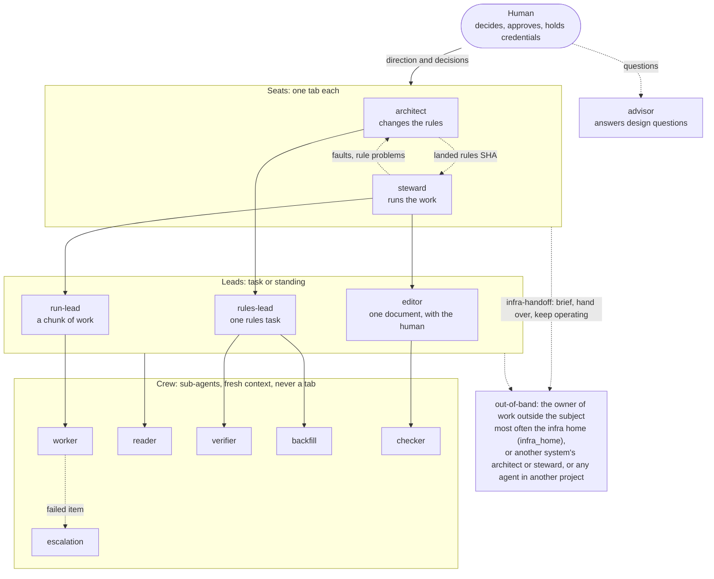

# watchbill

A role model for multi-agent work in [herdr](https://herdr.dev) with a human in the loop,
packaged as a Claude Code plugin. A watch bill is the roster that says who stands which watch,
who relieves whom, and who keeps the log. Here the watches are the seats agents hold, relief is a
two-party handoff, and the log is commit trailers, item records and a historian.

**One seat changes the playbook, another runs the work, and every relief leaves a log.** The
**playbook** is the system's rules: schema, code, skills, briefs, README.

It is for anyone who runs a standing agentic system (an inbox of items worked under written
rules) or a build cycle with several agents, and wants each agent to know what it may write,
whom it answers to, and how the human's decisions are recorded.

## The seats

| Seat | Write class | Manages | Lives |
|---|---|---|---|
| **Playbook Architect** ("the architect") | rules | the system's playbook. Edits in a git worktree, lands with `watchbill land` between the steward's items, watches outcomes after the gate | tab 0 of the system's workspace; parks there with `👁` while its watch is armed |
| **Steward** | work | the inbox: new items, the human's decisions, confirmations, under the current rules; stamps the rules SHA on every item | tab 1, in the primary checkout |
| **Rules lead** | rules | one bounded rules task, inside the files its brief assigns | its own tab; closed by the architect once its report is filed |
| **Run lead** | work | a chunk of work under the current rules; sends rule problems, never edits rules | its own tab; closed by the steward |
| **Editor** | work | one document's text with the human, as signed Track Changes suggestions | a standing run lead |
| **Advisor** | nothing | answers design questions on call | a tab, no glyph |
| **Crew** | work or nothing | one step each, fresh context: worker, reader, verifier, backfill, checker, escalation | sub-agents, never a tab |
| **Historian** | nothing | history questions after a handoff | `↪` tab, last |

### Org chart

Each box is one of the plugin's agents (`watchbill:<name>`). Solid arrows show who spawns whom.
Dotted arrows show messages and reports.



Any seat or lead may spawn any crew type. The arrows show only the usual pairings. Work outside
the system's subject is handed out of band to whoever owns it (`watchbill:infra-handoff`): a live
owner gets a message, otherwise one is started in that home's own workspace. A seat that
hands off becomes a historian, which answers history questions only. That is a state of the
seat, not a separate agent.

Architect and steward run side by side and message each other only with information (no acks, no
pauses). A message from another agent never carries the human's authority, and silence is never
consent: an approval is a recorded decision, bound to one change and spent once.

## What is in the plugin

| Part | For |
|---|---|
| `skills/` | `watchbill` (the map), `architect`, `steward`, `delegation`, `paper-trails`, `watchers`, `collaborative-drafting`, and the session skills (`handoff-session`, `historian`, `multi-agent-routing`, `monitoring-mode`, `herdr-workspace-placement`, `role-relaunch`, `infra-handoff`, `lead-and-crew`) |
| `agents/` | one agent per seat and per crew sub-type, with model, effort and tools pinned (`--agent watchbill:architect`, `subagent_type: watchbill:reader`) |
| `hooks/` | session context (configuration, overlay, the seat's primer), an ownership warning from `dev-docs/owners.yaml`, a model guard, a hold guard, a context-band notice, and a commit-msg check for `Watchbill-Event` trailers |
| `bin/` | `herdr-lifecycle` (spawn seats, labels and glyphs, two-party handoff and relief, park, shelve and unshelve, exit), `watchbill` (`status`, `land`, `rules-sha`, `restore`, `config`, `context`, `check-note`, `hold`, `install-links`) |
| `evals/` | cases for `claude plugin eval` |

## Install

Requirements: Claude Code, [herdr](https://github.com/herdrdev/herdr) (tested on 0.9.3), Python 3
(PyYAML optional). Optional: Obsidian with the Track Changes plugin and the `obsidian-track-changes-agent` Claude plugin (its `obsidian-track-changes-agent` command is the drafting tool), for collaborative drafting.

```
/plugin marketplace add johntrandall/claude-plugin-watchbill
/plugin install watchbill@watchbill
```

The plugin's `bin/` is on the Bash tool's PATH inside Claude. For launchers and shells outside
Claude, run `watchbill install-links` once after each update: it points `~/.local/bin` links at
the installed copy. To try a clone without installing: `claude --plugin-dir <clone>`.

## Configuration

Nothing about you is built in. Set values in `/plugin configure watchbill@watchbill`, or from a
shell with `claude plugin configure watchbill@watchbill --values-stdin`. A
`WATCHBILL_<KEY>` environment variable overrides a configured value. `watchbill config --explain`
prints every value and where it came from; a SessionStart hook prints them into each session's
context, so skills and agents can stay in generic wording ("the human", "a forbidden model").

**Keep a copy outside Claude Code's plugin store.** Plugin options live in `settings.json` under
`pluginConfigs`, and a reinstall or a marketplace re-registration can empty that entry (it did on
2026-10-15). watchbill also reads a config file of its own, `~/.claude/watchbill.json`
(`$CLAUDE_CONFIG_DIR/watchbill.json`; `$WATCHBILL_CONFIG_FILE` overrides), a flat `{KEY: value}`
object, after the settings entry and before the defaults. `watchbill config --write-file` writes
every non-default value into it once; after that a wiped settings entry changes nothing, and the
session context says "No configuration found" only when both are empty. Order of precedence:
`EVAL_WATCHBILL_<KEY>`, `WATCHBILL_<KEY>`, `CLAUDE_PLUGIN_OPTION_<KEY>`, the settings entry, the
config file, the default.

Maturity says how far each option is built:

- **Works, tested**: code acts on the value, and the test suite covers it.
- **Works**: code acts on the value, but no test covers that option on its own.
- **Guidance**: the value is printed into every session's context and the skills tell seats to
  follow it, but no code checks that they do.
- **Planned**: something the option points at is not built yet (see
  `skills/watchbill/references/built-and-planned.md`).

| Option | Default | Other values | Maturity | What it does |
|---|---|---|---|---|
| `human_name` | `the human` | any name | Works, tested | how seats name you in messages, status and the seat primer |
| `forbidden_models` | none | a list of model aliases or IDs (`opus`, `sonnet`, `haiku`, a full model ID); an entry `<role>: <models>` (`architect: none`, `steward: fable haiku`) is that role's own list, replacing the every-role entries for it | Works, tested | the model guard denies an Agent call or `claude` launch with one, and `spawn` refuses it; the role checked is the one being launched (`spawn --seat <kind>`, `claude --agent watchbill:<role>`, a watchbill `subagent_type`), else the every-role list |
| `require_explicit_model` | `true` | `false` | Works, tested | inside a system, denies a `claude` launch or plain `spawn` with no model, and reminds a generic Agent call that names none |
| `alert_channels` | `tab glyph only` | free text, in order (for example `kiosk, then Pushover`) | Guidance (the `?` tab glyph itself works, tested) | how a seat stopped on you gets your attention; each channel past the glyph needs a tool the seat actually has |
| `decision_channels` | `chat` | free text (for example `chat, Track Changes notes, boards`) | Guidance | where you give decisions; each system's brief names its channels from this |
| `drafting_tool` | `obsidian-track-changes-agent` (the obsidian-track-changes-agent plugin's command, on PATH) | a command name or a path to another tool with the same subcommands | Works, tested with the obsidian-track-changes-agent tool; Guidance for any other | the Track Changes tool the editor and checkers use |
| `drafting_author` | your `human_name` | any name | Guidance | the author your Track Changes marks carry; seats and watchers treat marks by that author as yours |
| `headroom_command` | none | any command; exit 0 means room | Works, tested | a check `spawn` runs first; non-zero refuses the spawn |
| `scheduler` | `none` | the name and state of a scheduler (for example `cron, enabled`) | Guidance; a scheduled wake of a seat is Planned | what may restart or wake a seat; with `none`, nothing does, and seats say so |
| `infra_home` | none | a project folder | Guidance | where a fault outside a system's subject is handed; with none, to you |
| `workspace_label` | `{SUBJECT} system` | any pattern; `{SUBJECT}` becomes the subject in capitals | Works, tested | the herdr workspace label per system |
| `overlay_file` | none | the path to a markdown file | Works, tested | a private file of your own rules, printed into every session at start; if set but missing, the context says so |
| `relief_deadline_minutes` | `30` | any whole number from 1 | Works, tested | how long either side of a relief waits before `relief-check` acts |
| `handoff_offer_tokens` | `400000` | any number from 1 | Works, tested | context size at which a seat is told, once, to offer you a handoff, for cost |
| `handoff_hard_percent` | `85` | 1 to 100 | Works, tested | percent of the window past which a seat is told on every prompt to hand off |
| `context_window_tokens` | `1000000` | any number from 1 (for example `200000`) | Works | the window size the percent is taken of |

After an update, relaunch or hand off any seat that is already running. In our use, a running
session kept the hooks of the version it started with (observed, not tested on its own).

**The overlay file** carries rules that are yours alone (which shelf a monitoring session moves
to, which sign-in screens an agent must never complete, what memory a brief should not load).
If it is configured but missing, the session context says so.

## Starting a system

Ask any session to set up a watchbill system for a subject; `watchbill:watchbill` routes it. In
short: one herdr workspace per system; a README with a `Roster` table; `dev-docs/owners.yaml`
(who writes what) and `dev-docs/decisions.md` (your decisions); the trailer check installed with
`hooks/git/install-commit-msg.sh`; your yes to the roster and gate before anything is spawned.
`watchbill status <system-dir>` answers "who has the ball" from records; `watchbill restore
<system-dir>` brings seats back after a usage limit or a reboot.

## Licence

MIT. See `LICENSE`. Changes: `CHANGELOG.md`.
